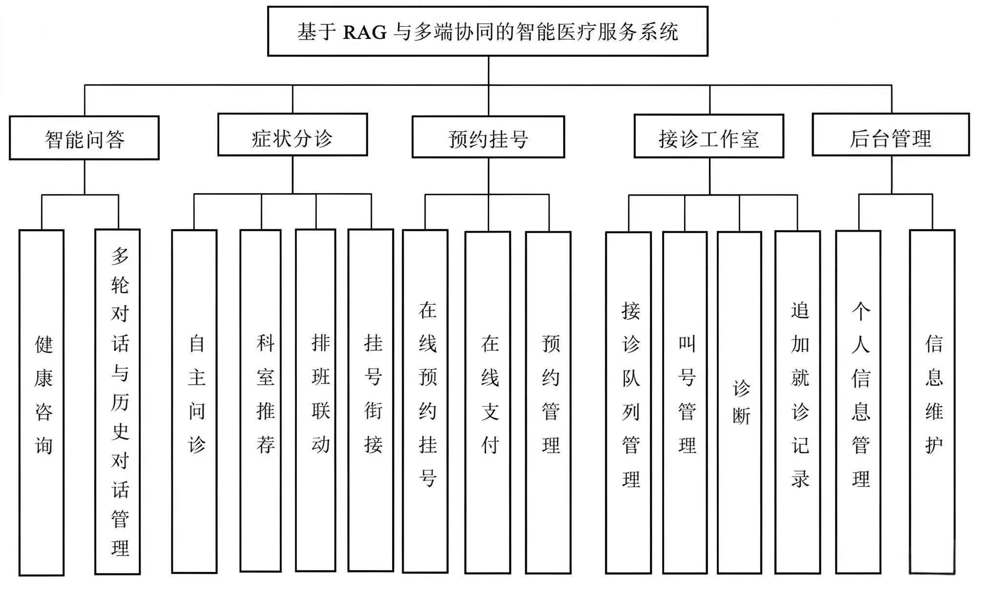
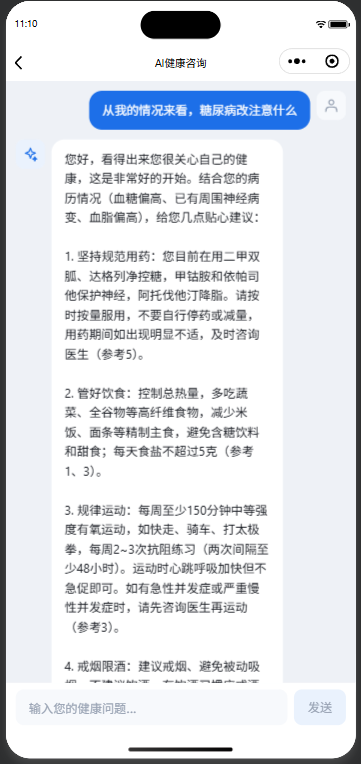
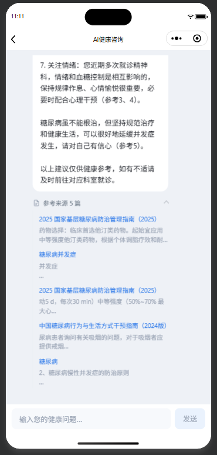
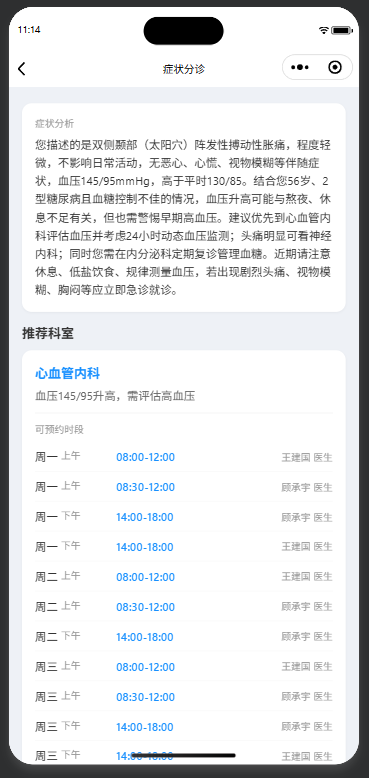
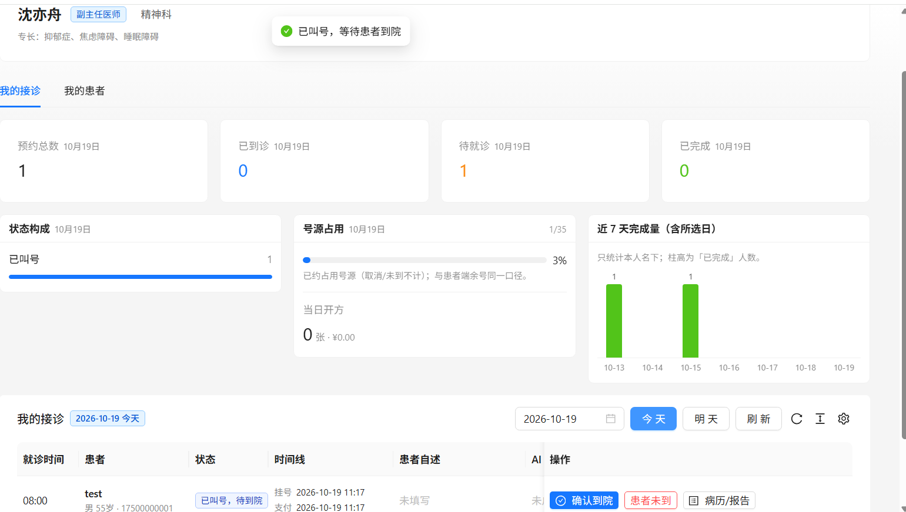
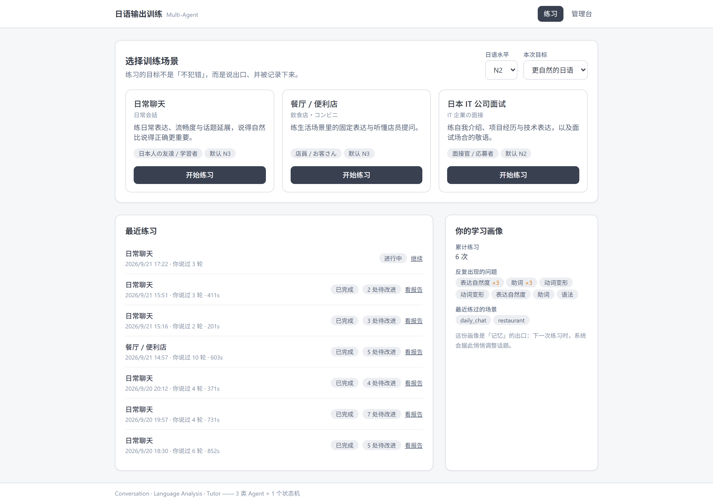
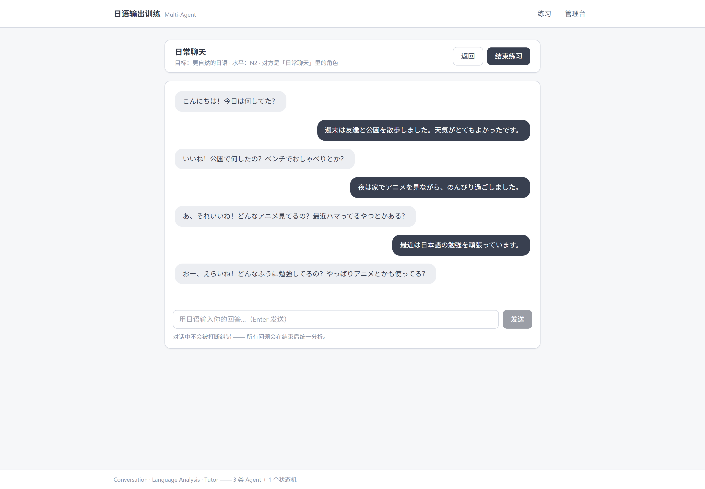
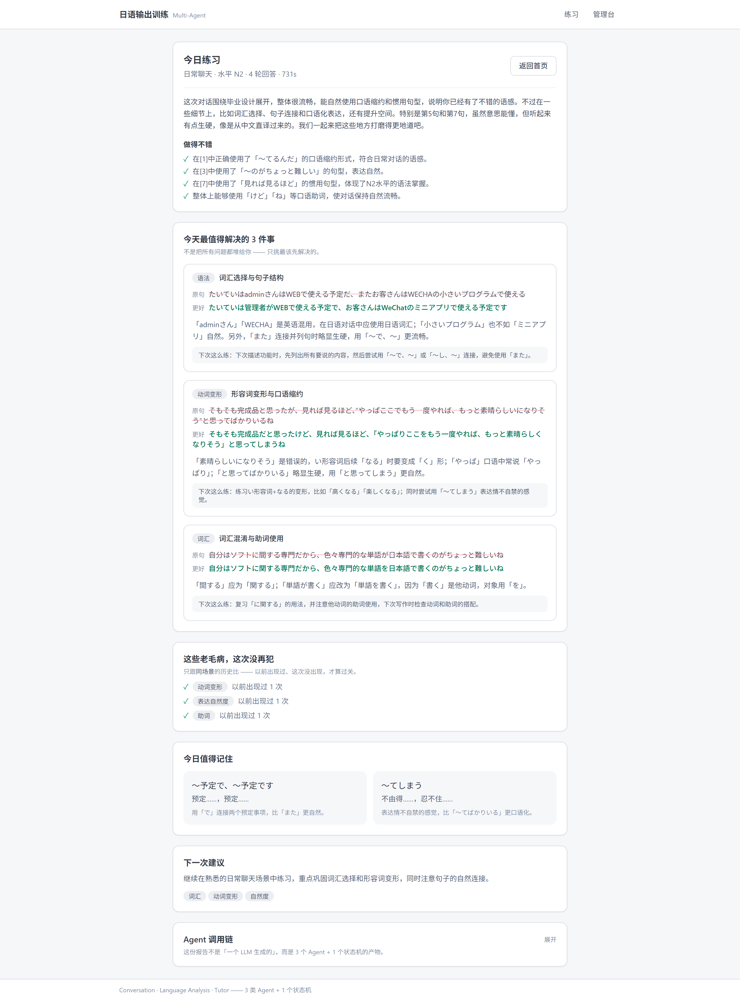
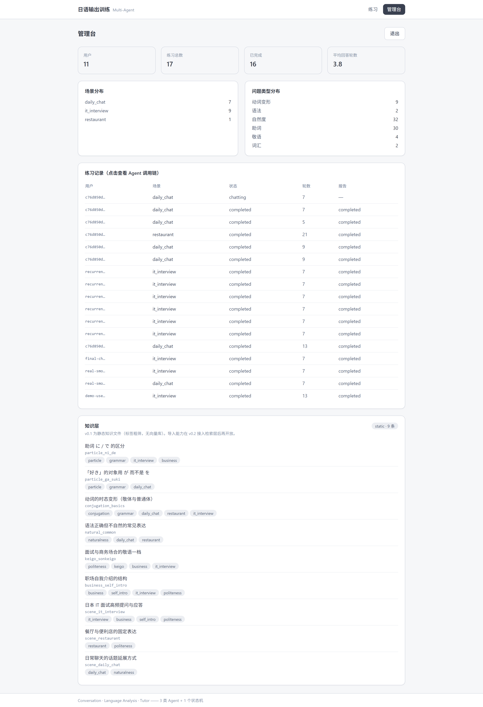

# 作品集

> AI 应用开发方向 · RAG 检索优化 / Multi-Agent 编排 / 多端系统落地

---

## 项目一 · 智能医疗导诊系统

**RAG + 三端协同的就医闭环**

患者在微信小程序里描述症状 → 系统检索医学指南给出**带出处**的回答 → 追问补全关键信息后**推荐科室** →
结果直接衔接挂号；医生端与运营后台跑在同一套后端上。

  

  
  
  
  

左起：AI 导诊对话 → 参考来源 → 分诊结论 → 医生接诊台

### 指标

| 指标 | 数值 |
|---|---|
| 后端业务端点 | **115**（管理 58 / 医生 19 / 患者 38） |
| 业务数据表 | **23** |
| 检索 Hit@1（109 题评测集） | **0.7300** ｜ Recall@5 **0.9000** ｜ MRR **0.7940** |
| 检索改进（早期 44 题子集） | Hit@1 0.5897 → **0.8205** ｜ Rec@5 0.7949 → **0.9231** ｜ MRR 0.6590 → **0.8641** |
| 分诊选科 top-1（local 47 例） | **0.9362** ｜ 急症识别 **1.0000** |
| 生成 F1 / Recall（46 题迷你集） | **0.9103 / 0.9167** |
| 复用同一套生成组件的 AI 管线 | 6 条 |

### 做过的三件难事

**1. 让回答带出处，而不是让模型自由发挥**
检索命中的 chunk 与正文里的角标一一对应，来源列表在正文流式输出结束后补齐，两者共用同一批 chunk id。
点开能看到指南名称、发布年份和命中片段。

**2. 该拒就拒**
粗排 top-1 相似度低于 `0.536` 时直接拒答、**不调 LLM**。实测拦下 5/5 应拒题，误伤 0/39。
关键设计：精排会重排 #1，所以拒答闸门读的是**粗排池**的分数，与精排解耦。

**3. 科室不许胡造**
模型只能在实际开设的科室中选，白名单写在代码里而不是提示词里。给出白名单外的科室会被判无效并重试。

[查看完整技术说明 →](projects/medical-rag.md)

---

## 项目二 · 日语口语输出训练系统

**三个主 Agent + 一个质检 Agent，而不是一个大 Prompt**

用户在有场景的对话里说日语（可打字或语音转写），练习中**不纠错**；结束后统一分析、
记录问题、按规则安排下次练什么 —— 目标是逼出输出，而不是做「网页版 ChatGPT」。

  
  

  
  

场景选择 → 练习 → 结构化报告 → 管理台 Agent 调用链

### 三条设计取舍

**1. 真分工，不是一个大 Prompt**
对话陪练、练习后分析、教学建议由不同 Agent 分阶段完成，各自有独立的系统提示与**输入隔离**
（明确「不可做什么」），而不是让一个模型既陪练又批改。

**2. 「记住你」是可解释的统计，不是黑盒记忆**
反复出现的语言问题由代码计数；「这次没再犯」按同场景历史对比；下次练什么由规则按薄弱类型决定。
模型负责生成内容，状态判定交给代码。

**3. 双契约：按「谁消费这个字段」拆分**
`schemas/agents.py` 面向 LLM、`schemas/api.py` 面向 HTTP，两套契约分开维护。
代价是要同步两处，收益是改 API 不会意外影响提示词结构。

[查看完整技术说明 →](projects/multi-agent-ja.md)

---

## 技术栈

| 层 | 用过什么 |
|---|---|
| **大模型 / 检索** | qwen3-max（DashScope）、BAAI/bge-base-zh-v1.5、bge-reranker-base、LangChain、ChromaDB、BM25 混合检索 |
| **后端** | Python / FastAPI、Celery、SQLAlchemy、Alembic、SSE 流式输出、JWT |
| **数据 / 存储** | PostgreSQL、SQLite、Redis、MinIO |
| **前端** | React 18 + TypeScript、uni-app（Vue 3）微信小程序 |
| **工程** | Docker Compose 六服务编排、uvicorn、Vitest / Pytest |

---

## 工程习惯

- **先量后调**：动检索参数前先用离线探针量出「池覆盖上界」，不拿全量复测当试错器。
- **评测分三把尺子**：检索 / 生成 / 分诊分开评，避免一个综合分掩盖短板。
- **写清边界**：两个项目都各自维护一份「已知短板」清单，如实列出还没解决的问题。
  比如医疗项目的跨篇检索仍偏弱、支付验签是演示用 mock、可用性人测尚未做。

---

